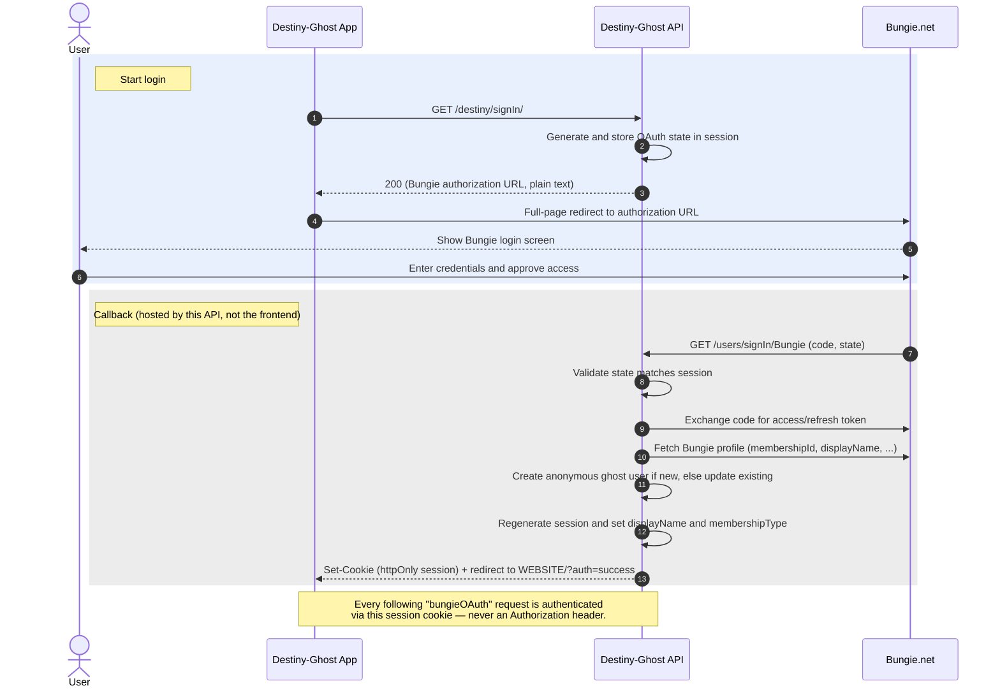
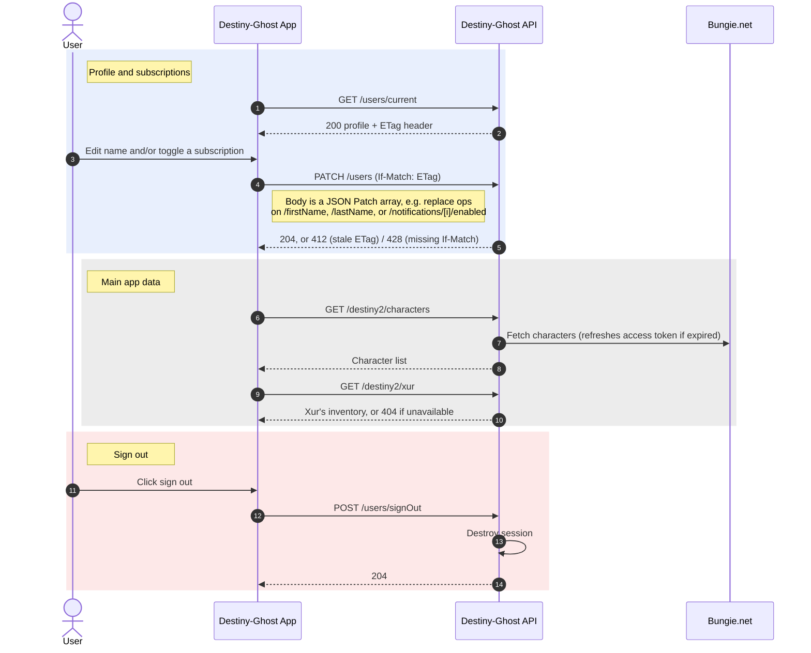

# Destiny-Ghost API — Frontend Reference Flows

These diagrams reflect the actual implemented behavior of the API (routes, controllers, and services), not just the OpenAPI documentation. Three notable corrections vs. what you might assume from `openapi.json`'s `bungieOAuth` security scheme:

* **Auth is a session cookie, not a bearer token.** The frontend never holds or forwards a Bungie access token. It's exchanged server-side, and an httpOnly session cookie is what authenticates every subsequent `bungieOAuth`-secured request.
* **`PATCH /users`, not `PATCH /users/{userId}`.** The user is identified entirely by the session cookie; there is no path parameter.
* **Registration is a single combined two-factor step**, not two independent ones. `POST /users/signUp` fires an SMS code and an emailed link from one token pair with a shared 15-minute TTL; `POST /users/join` validates both together in one call.

Admin/back-office endpoints (manifest upload, inventory, notification broadcast triggers) are gated by the `Destiny-Ghost-Authorization` API key, not user login, and are out of scope for these diagrams.

## 1. Bungie OAuth / Session Login



## 2. Registration + Two-Factor Verification

```mermaid
sequenceDiagram
    autonumber
    actor User
    participant WebApp as Destiny-Ghost App
    participant API as Destiny-Ghost API
    participant SMS as Twilio (SMS)
    participant Email as Email (SMTP)

    rect rgba(100, 150, 240, 0.15)
        note right of User: Detect incomplete registration
        WebApp->>API: GET /users/current
        API-->>WebApp: 200 (anonymous profile — no dateRegistered/email/phone)
        WebApp-->>User: Show registration form
    end

    rect rgba(128, 128, 128, 0.15)
        note right of User: Submit contact info
        User->>WebApp: Enter first/last name, phone, email
        WebApp->>API: POST /users/signUp (firstName, lastName, phoneNumber, emailAddress)
        API->>API: Validate fields and normalize phone to E.164 (422 for CN/KP/RU region codes or a bad field)
        API->>API: Queue the sign-up
        API-->>WebApp: 204 once queued, whether or not the contact is registered to another account (nothing is sent then) or the messages go out; 429 after 5 sign-ups an hour
        note right of API: The rest runs on the sign-up worker, so the answer's timing discloses nothing
        API->>API: Generate one token pair: SMS code + email blob, shared 15-min TTL
        API->>API: Save the contact as pending (membership.pending); the account's current contact, if any, is untouched
        par Send SMS
            API->>SMS: Send "Enter [code] to verify your phone number"
            SMS-->>User: Deliver SMS
        and Send Email
            API->>Email: Send link WEBSITE/register?token=[blob]
            Email-->>User: Deliver email
        end
    end

    opt A message didn't arrive
        User->>WebApp: Ask to resend the SMS or the email
        WebApp->>API: POST /users/signUp/resend (channel)
        API-->>WebApp: 204 once queued, whether or not there was a pending sign-up or the send works; 429 after 3 per channel per 15 min
        API->>SMS: Resend the same code, or Email: the same link, to the pending contact (other channel and tokens untouched)
    end

    rect rgba(80, 200, 120, 0.15)
        note right of User: Confirm both channels together
        User->>WebApp: Click emailed link → opens /register?token=[blob]
        WebApp-->>User: Prompt for the SMS code
        User->>WebApp: Enter SMS code
        WebApp->>API: POST /users/join (tokens: emailAddress=[blob], phoneNumber=[code])
        API->>API: Validate both against the token pair's TTL, for the session's own sign-up
        API->>API: Re-check the pending contact isn't registered to another account
        API->>API: Promote the pending contact to the account's contact; consent for a new number from its consent marker, else subscribed
        API->>API: First sign-up only: set dateRegistered, seed notifications (Orders, Banshee-44, Lord Saladin, Xur, all disabled), send welcome SMS
        API-->>WebApp: 200 success, or 400 if expired/mismatched/conflicting (resubmit signUp to retry)
    end

    note over WebApp,API: Changing phone or email: a registered user signs up again with the new contact<br/>and joins; the old contact stays in place until join succeeds.
```

## 3. Authenticated App Usage


